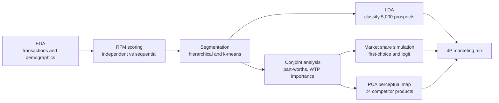
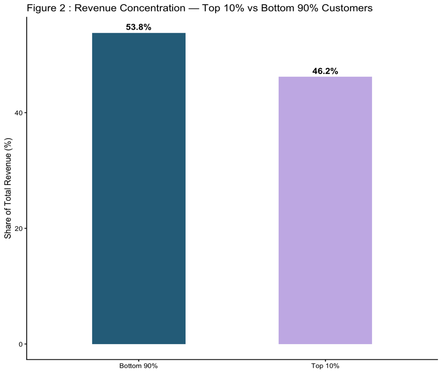
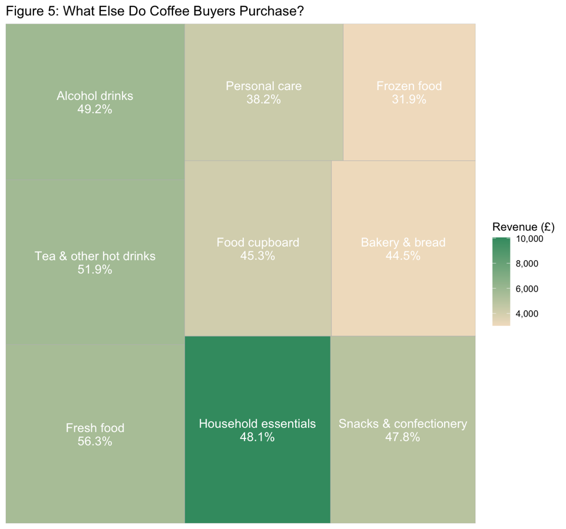
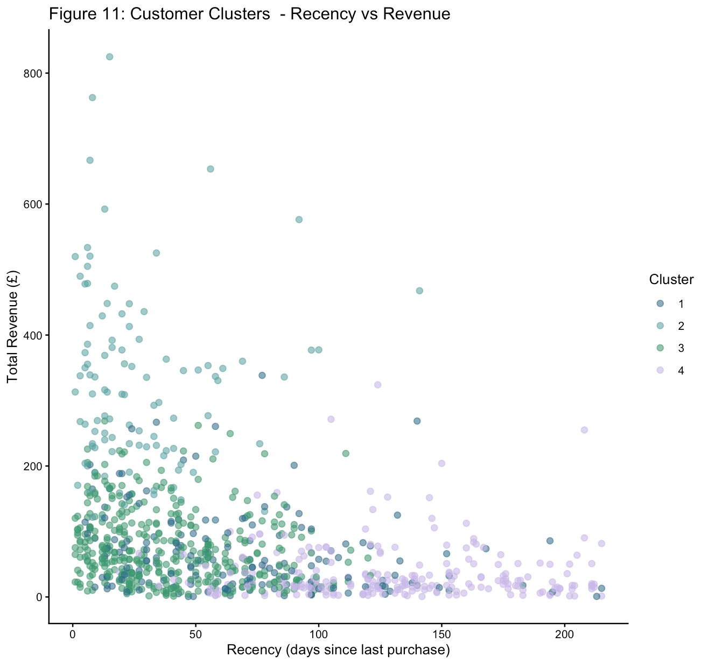
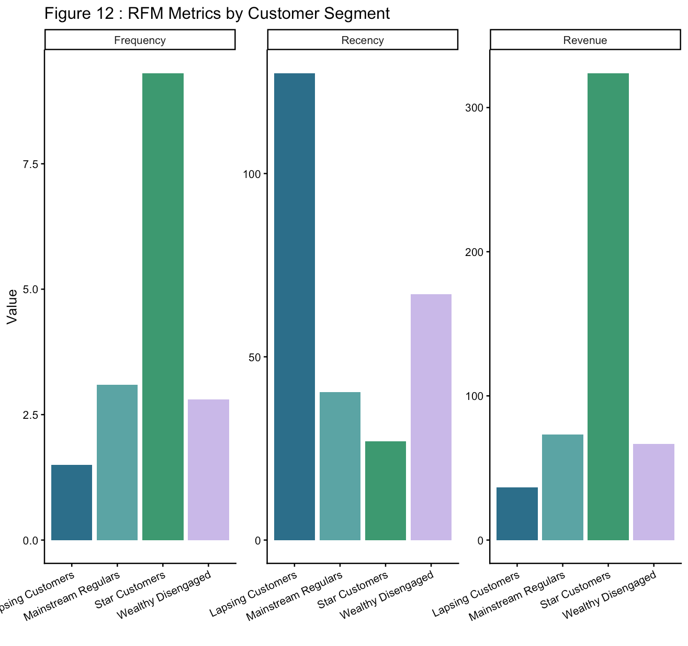
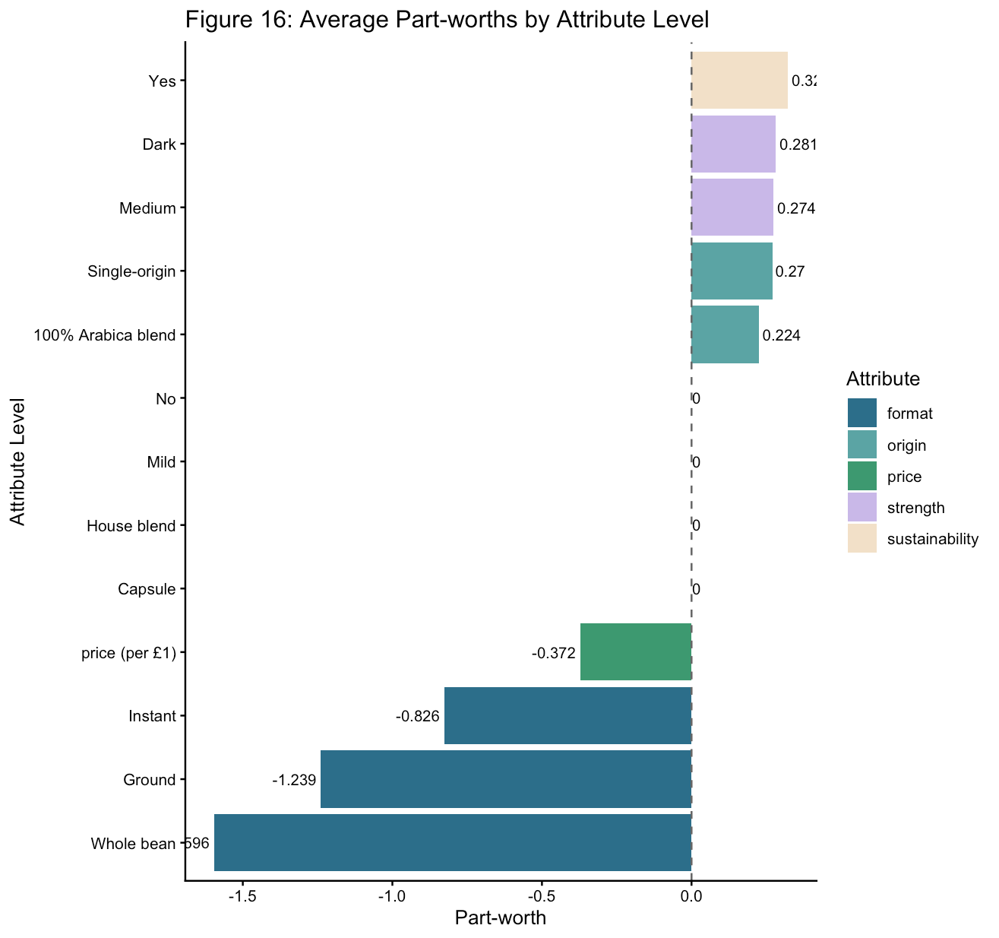
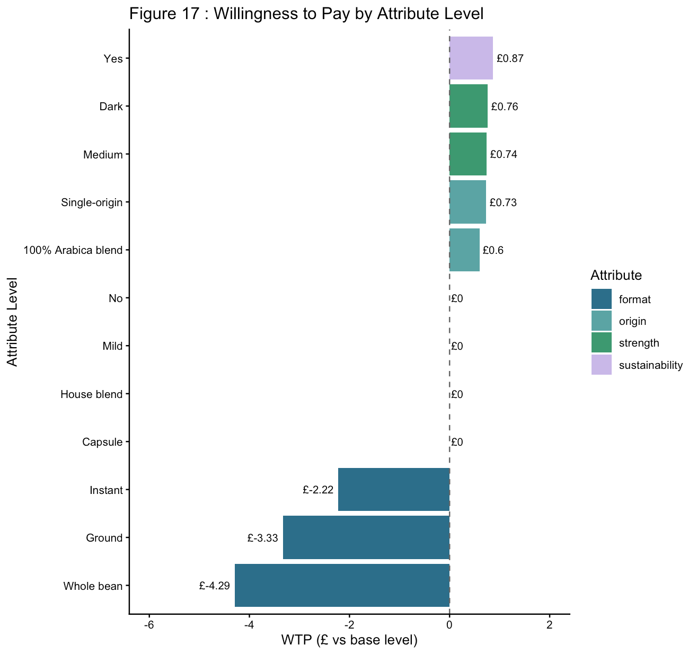
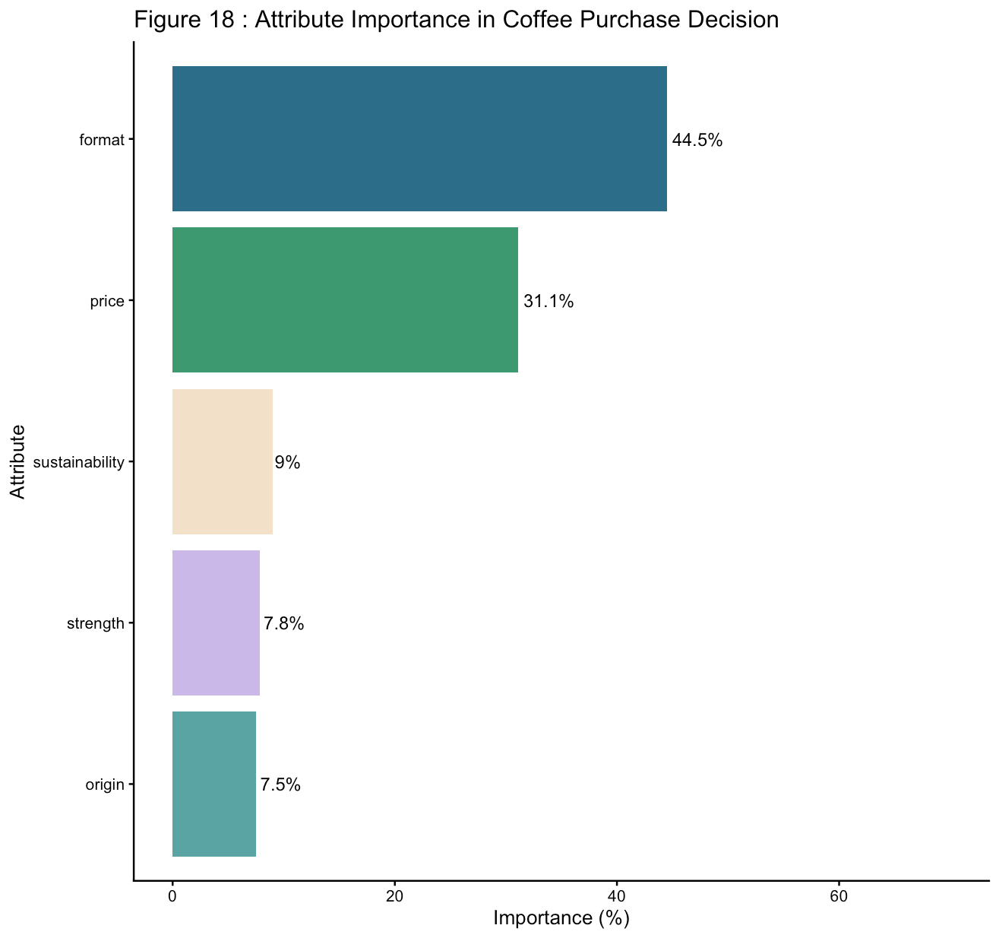
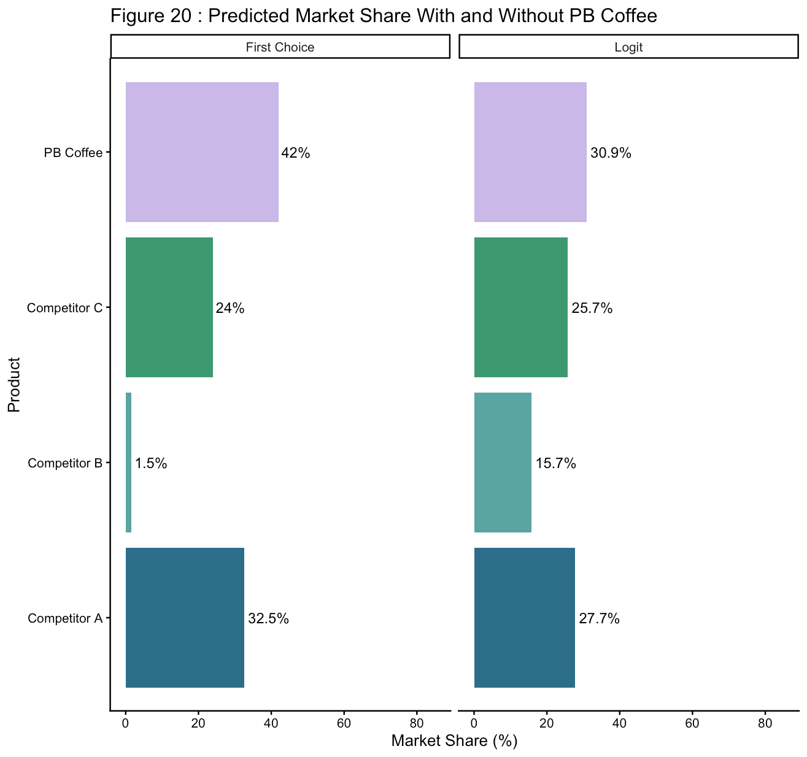
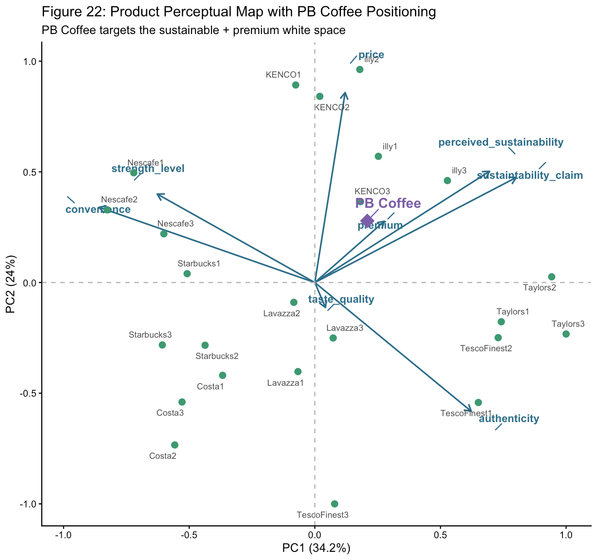

# Launching a Private-Label Coffee: Segmentation, Conjoint Analysis & Positioning

**MSc Business Analytics: Marketing Analytics (May 2026)**
**Author:** Ria Goel  ·  **Tools:** R · data.table · dplyr · ggplot2 · cluster · MASS · treemapify · ggridges · ggrepel · kableExtra

> A UK grocery retailer wants to launch its own-brand (private-label, PB) coffee. This project uses a data-driven **Segmentation, Targeting and Positioning (STP)** approach to answer three questions:
> 1. **Who** should the coffee be aimed at?
> 2. **What** product should it be, and at what price?
> 3. **Where** should it sit against competitors?
>
> The end result is a full **4P marketing-mix recommendation** (product, price, place, promotion).

---

## Key results at a glance

| | Result |
|---|---|
| **Customer value is concentrated** | The top 10% of customers generate **46.2% of revenue** (922 customers, 4,962 transactions) |
| **Demographics don't explain value** | High- and low-value customers look nearly identical by age, income and household size. Purchase behaviour is what separates them |
| **Target segment** | **"Star Customers"** (k-means, k = 4): 105 customers averaging **£323 revenue**, 9.3 orders and a last purchase 27 days ago, about 9× the revenue of lapsing customers |
| **Prospects** | LDA classified **5,000 prospects** and found **47 new Star Customers** to target |
| **What customers value** | **Format (44.5%)** and **price (31.1%)** drive 75.6% of the purchase decision. Capsule format is strongly preferred |
| **Willingness to pay** | Sustainability **+£0.87**, Dark roast +£0.76, Single-origin +£0.73 |
| **Recommended product** | Capsule · Dark roast · 100% Arabica · Sustainable · **£5** |
| **Predicted market share** | **42%** (first-choice rule) and **30.9%** (logit rule), making it the market leader |
| **Positioning** | A gap in the **premium + sustainable** space, close to KENCO and Illy but at a more accessible price |

---

## Approach



### 1. Exploratory data analysis
- **Cleaning:** removed rows with missing categories and duplicate rows, and built a spend measure for each transaction.
- **Customer profiles:** aggregated spend and demographics to one row per customer.
- **Findings:** spend is very uneven across customers (a near-Pareto pattern), and coffee is the #2 revenue category, peaking in January.

 

### 2. Segmentation and targeting
- **RFM scoring** (recency, frequency, monetary value) used quintiles, with **independent and sequential** sorting compared. The two methods assigned different scores to 88.5% of customers. Sequential sorting was preferred because it ranks customers within each recency group.
- **Clustering:** hierarchical clustering (Ward's D2) and **k-means** were run on standardised RFM and demographic variables. k = 4 was chosen using elbow and silhouette plots, and results were stable across 1–50 random starts.
- **LDA** (linear discriminant analysis) on demographics:
  - Two significant discriminant functions (LD1: F = 644, p < 0.0001). Overall accuracy was 64.5%.
  - LDA could identify Star Customers only 2.9% of the time, because what sets them apart is their behaviour, not their demographics.
  - Used to classify **5,000 prospects**.

| Segment | n | Avg recency (days) | Avg orders | Avg revenue | Avg income | Role |
|---|---|---|---|---|---|---|
| **Star Customers** | 105 | 26.9 | 9.3 | **£323.64** | £67.7k | 🎯 Primary target |
| Mainstream Regulars | 399 | 40.3 | 3.1 | £73.30 | £47.4k | Secondary pool, responsive to promotions |
| Wealthy Disengaged | 162 | 67.1 | 2.8 | £66.63 | £148.1k | High income but low spend |
| Lapsing Customers | 246 | 127.3 | 1.5 | £36.43 | £50.3k | Disengaging |

 

### 3. Conjoint analysis: what should the product be?
- **Survey design:** a **fractional factorial design** of 16 profiles was used instead of a full design of 288. It was rated by 200 Star Customers on a 7-point scale.
- **Part-worths:** estimated with **individual-level OLS** (one regression per respondent) and **aggregate OLS** (all respondents together).
- **Derived measures:** **willingness to pay (WTP)** for each feature, attribute importance, and the spread of individual part-worths.

 



### 4. Market share simulation
Each respondent's own part-worths were used to simulate choices among three competitors, with and without PB Coffee, using the **first-choice** and **logit** share rules.

| Product | First choice | Logit |
|---|---|---|
| **PB Coffee** | **42.0%** | **30.9%** |
| Competitor A | 32.5% | 27.7% |
| Competitor C | 24.0% | 25.7% |
| Competitor B | 1.5% | 15.7% |



### 5. Positioning: PCA perceptual map
- **PCA** was run on 24 competitor products using 8 perceptual and objective attributes. PC1 and PC2 explain 58.2% of the variance.
- PB Coffee was then plotted on the same map using the same scaling. It lands in the **premium + sustainable** gap.



## 4P recommendation
| | Recommendation |
|---|---|
| **Product** | Capsule, Dark roast, 100% Arabica, with certified sustainability (Fairtrade or organic) |
| **Price** | £5, with room for a premium tier at £5.50–£6 based on WTP |
| **Place** | Premium shelf space in the coffee aisle, plus secondary placement near fresh food (56.3% of coffee buyers also buy fresh food), near capsule-machine accessories, and online |
| **Promotion** | Two messages: lead with format and price for everyone, then add sustainability and origin stories for the sub-group who care most. Use loyalty scheme communications, email and in-store sampling |

## Limitations
- LDA accuracy is limited (64.5%) because only demographics were available for prospects.
- The conjoint sample comes from one retailer's customers.
- The 2-D perceptual map captures only 58% of the variance.
- The market simulation assumes competitors don't react.

## Repository structure
```
├── README.md
├── code/
│   └── marketing_analytics.R          # Full analysis: EDA → RFM → clustering → LDA → conjoint → market share → PCA
├── figures/                           # Key figures from the report
└── report/
    └── Marketing_Analytics_Report.pdf # Full report (3,253 words + appendices)
```

## How to run
The datasets (retail transactions, prospects, conjoint profiles and survey, product attributes) were provided by the module team and are not redistributed here. Place the CSV files named in the script in your working directory and run `code/marketing_analytics.R`. The random seed is fixed at `40481810`.

## Skills demonstrated
`R` · `data.table` · `customer analytics` · `RFM analysis` · `hierarchical clustering` · `k-means` · `silhouette analysis` · `linear discriminant analysis` · `conjoint analysis` · `willingness-to-pay` · `market share simulation` · `PCA / perceptual mapping` · `STP` · `4P marketing mix` · `data visualisation (ggplot2)`

---

*AI assistance was used for debugging parts of the code, as noted in the code comments. The analysis and recommendations are the author's own.*
